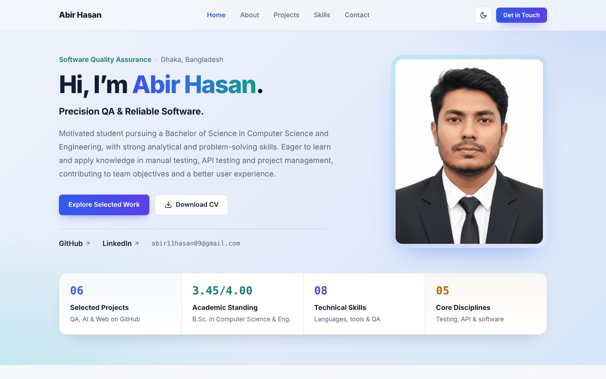
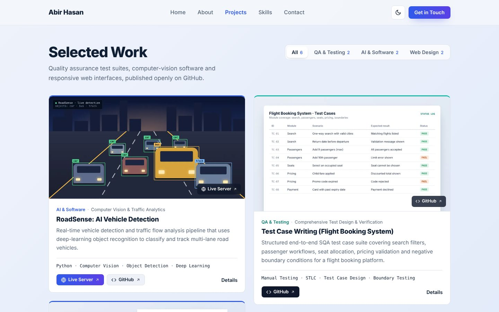

# Abir Hasan | Personal Portfolio

A multi-page personal portfolio website for **Abir Hasan**, a Computer Science and Engineering student at Daffodil International University focused on **Software Quality Assurance and testing**.

Built from scratch with **HTML, CSS, JavaScript, jQuery and Ajax**, with no templates or CSS frameworks.



## Live demo

After you enable GitHub Pages (see [Deploy on GitHub Pages](#deploy-on-github-pages)), the site is available at:

```
https://abirhasan11.github.io/<repository-name>/
```

## Pages

| Page | File | What it shows |
| --- | --- | --- |
| Home | `index.html` | Introduction, photo, stats, what I do, featured work, testing process |
| About | `about.html` | Personal introduction, profile facts, academic background, soft skills, interests |
| Projects | `projects.html` | Selected work with cover images, filter tabs, Live Server and GitHub links, details popup |
| Skills | `skills.html` | Technical capabilities and my 8-step testing process |
| Contact | `contact.html` | Contact details and a validated contact form |

## Features

- **Ajax data loading**: projects and education are loaded from JSON files with `$.ajax`, so content is kept separate from the HTML.
- **Project filter**: tabs for All, QA & Testing, AI & Software and Web Design, with live counts and a two-column card layout.
- **Project details popup**: opens with the project description, highlights and links; closes with the close button, a click outside or the Escape key.
- **Counting stats**: the home page stats count up on load with a jQuery animation.
- **Interactive testing process**: each STLC step expands on click or with the keyboard.
- **Contact form validation**: checks name, email and message, shows clear errors, then opens the visitor's email app with the message filled in.
- **Light and dark theme**: switch saved in `localStorage`, defaults to the system setting.
- **Responsive design**: tested on phones (360px, 390px), tablets (768px, 1024px) and laptops (1280px, 1536px).
- **Accessibility**: skip link, visible focus, alt text, labelled form fields, `aria-live` updates and reduced motion support.
- **Download CV** button on the home and about pages.

<p>
  
  
</p>

## Tech stack

| Technology | Used for |
| --- | --- |
| HTML5 | Semantic page structure |
| CSS3 | Layout with Flexbox and Grid, CSS variables for theming, media queries |
| JavaScript (ES5) | Page logic |
| jQuery 3.7.1 | DOM handling, events, animations |
| Ajax + JSON | Loading project and education data |

Fonts: Plus Jakarta Sans, Inter and JetBrains Mono from Google Fonts.

## Project structure

```
abir-hasan-portfolio/
├── index.html
├── about.html
├── skills.html
├── projects.html
├── contact.html
├── css/
│   └── style.css              # all styles, light/dark theme, responsive rules
├── js/
│   ├── main.js                # jQuery code for every page
│   ├── fallback-data.js       # copy of the JSON data for file:// use
│   └── jquery-3.7.1.min.js    # jQuery, stored locally so the site works offline
├── data/
│   ├── projects.json          # project cards (loaded with Ajax)
│   └── education.json         # academic background (loaded with Ajax)
├── assets/
│   ├── Abir-Hasan-CV.pdf
│   └── img/
│       ├── abir-portrait.jpg
│       └── projects/          # project cover images
├── docs/screenshots/          # images used in this README
├── .nojekyll
└── README.md
```

## Run locally

Browsers block Ajax requests on pages opened straight from disk (`file://`), so run the site on a local server:

**VS Code:** install the **Live Server** extension, open the folder, right-click `index.html` and choose **Open with Live Server**.

**Python:**

```bash
cd abir-hasan-portfolio
python -m http.server 8000
```

Then open `http://localhost:8000`.

If you double-click `index.html` instead, the site still works: it shows a built-in copy of the data from `js/fallback-data.js`.

## Push to GitHub

```bash
cd abir-hasan-portfolio
git init
git add .
git commit -m "Add personal portfolio website"
git branch -M main
git remote add origin https://github.com/abirhasan11/<repository-name>.git
git push -u origin main
```

Create the empty repository on GitHub first, without a README, so the push does not conflict.

## Deploy on GitHub Pages

1. Open the repository on GitHub and go to **Settings → Pages**.
2. Under **Build and deployment**, set **Source** to **Deploy from a branch**.
3. Choose the **main** branch and the **/ (root)** folder, then **Save**.
4. After a minute or two the site is live at `https://abirhasan11.github.io/<repository-name>/`.

To use the shorter address `https://abirhasan11.github.io/`, name the repository `abirhasan11.github.io`.

## Update the content

- **Projects:** edit `data/projects.json`. Each project has a title, category (`testing`, `ai` or `web`), description, tags, `repo` link, `live` link (`null` hides the Live Server button) and cover image.
- **Education:** edit `data/education.json`.
- **Cover images:** replace the files in `assets/img/projects/` with real screenshots, keeping the same file names.
- After editing a JSON file, copy the same change into `js/fallback-data.js` so the offline copy matches.

## Projects featured

| Project | Category | Links |
| --- | --- | --- |
| RoadSense: AI Vehicle Detection | AI & Software | [Live](https://roadsense.ai.studio/) · [Code](https://github.com/abirhasan11/roadsense-ai-vehicle-detection) |
| Test Case Writing (Flight Booking System) | QA & Testing | [Code](https://github.com/abirhasan11/SQA-assignment) |
| CV Maker AI | AI & Software | [Code](https://github.com/abirhasan11/CV-Maker-Ai) |
| Manual Testing (SauceDemo) | QA & Testing | [Code](https://github.com/abirhasan11/SauceDemo_test) |
| Nature’s Platter | Web Design | [Code](https://github.com/abirhasan11/assignment-3) |
| Kids Education School | Web Design | [Live](https://kidseducationschool.netlify.app/) · [Code](https://github.com/abirhasan11/assignment-2) |

## Author

**Abir Hasan**
B.Sc. in Computer Science and Engineering, Daffodil International University
Dhaka, Bangladesh

- Email: [abir11hasan09@gmail.com](mailto:abir11hasan09@gmail.com)
- LinkedIn: [linkedin.com/in/abirhasan11](https://www.linkedin.com/in/abirhasan11/)
- GitHub: [github.com/abirhasan11](https://github.com/abirhasan11)

---

© 2026 Abir Hasan. Designed and built by me.
